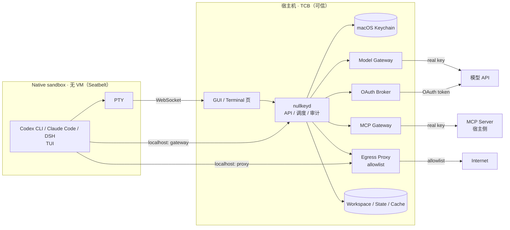

# Nullkey

> 桌面级 Agent 安全沙箱。Nullkey 管理的 API key、OAuth token、password 不注入沙箱。
>
> A desktop-grade secure sandbox for AI coding agents. Nullkey-managed credentials are never injected into the sandbox.

**Status:** v0.1.1 · Go daemon + Flutter GUI · macOS Apple Silicon · native runtime

## 为什么

Agent session 会以很多方式离开本机：transcript、日志、环境变量、MCP 配置、工作区文件、崩溃转储、截图。只要真实凭证在沙箱里，任何一次 session 泄漏都可能变成 key 泄漏。

Nullkey 将其管理的凭证与 Agent 运行环境分离：

- Nullkey 不向沙箱写入其管理的 API key、password、OAuth token、SSH key。
- 沙箱里的 harness / MCP 配置只有一枚 **per-sandbox token**（可撤销、只在当前沙箱有效）。
- 真实凭证只在宿主机：macOS Keychain + Nullkey daemon。
- 模型调用、MCP 调用、私有 git 都经过宿主侧 gateway，由 gateway 在沙箱外注入凭证。
- 沙箱默认走 `filtered` 网络：未认证流量经 egress proxy，认证流量经 gateway。
- 宿主机可通过 **service tunnel** 打开沙箱内 WebUI/preview；Agent 产物在 Artifacts 页审查。

**Nullkey 不把其管理的真实凭证写入沙箱状态。** 用户项目里的 `.env`、导入文件和主动粘贴的内容可能自带凭证；凭证检查不保证整个项目可安全导出或分享。

## 轻量优先

默认 runtime **不使用虚拟机**：

- 原生 macOS 进程沙箱（Seatbelt / `sandbox-exec`）+ 独立 workspace。
- 直接运行 Codex CLI、Claude Code、DSH 等 macOS 原生 harness。
- 默认界面是 **SSH-client 风格的终端页**（xterm.js + PTY），里面跑 harness 自己的 TUI；不是虚拟桌面。
- 冷启动目标 < 1s，daemon 常驻内存 < 80MB，单沙箱额外开销 < 40MB。
- 虚拟桌面/桌面应用是 **可选后端**，只在打开时启动；需要虚拟化，单独计量，不计入默认 SLO。

## 怎么工作



一次模型调用：

```text
Codex TUI → base_url=http://127.0.0.1:<gateway>/openai
          → Authorization: Bearer <per-sandbox token>
          → Gateway 校验 token，换成真实 key（API key 或 OAuth token）
          → 上游 API
          → 流式返回 TUI
```

一次私有 git：

```text
sandbox: git remote = http://127.0.0.1:<gateway>/git/github/<owner>/<repo>.git
gateway: 注入真实 GitHub 凭证 → github.com
token 不进入 sandbox
```

## 产品形态

- 本地 GUI：默认打开 SSH-client 风格的 **Terminal** 页，里面跑 harness 的 TUI；虚拟桌面在独立标签/窗口按需打开。
- 用户选择 harness/app：Codex（Must）、Claude Code / DSH（Should）、Codex app 等桌面端（可选 catalog）。
- Harness/app 不随安装包分发：宿主侧下载、固定版本/哈希、只读挂载或安装到缓存。
- 全局凭证：OAuth（宿主侧 broker）或 API key；所有沙箱共用，按沙箱 token 隔离。
- 关闭终端视图后任务继续，重新打开接回原会话；停止或删除沙箱保留 workspace/state，清理数据是独立操作。
- 状态持久化：workspace、harness state、cache 默认持久化并可在沙箱间共享。
- 所有配置由后端生成，用户不需要编辑 YAML 或在沙箱里填 key。

## 安全边界

**范围内**：session 泄漏导致的凭证泄漏。

- transcript / 日志 / 环境变量 / 进程参数
- harness 配置、MCP 配置、shell history
- workspace、state、缓存、崩溃转储
- 导出文件、共享终端、截图
- 宿主侧日志与 MCP server 日志

**范围外**：

- Agent 被 prompt injection 操控
- Agent 本身恶意、主动滥用自己的权限
- 目标网站/上游 API 被劫持
- 恶意 MCP server 实现
- 沙箱逃逸（提供进程沙箱；不宣称 VM 级隔离）
- 通过互联网/MCP/模型通道外发私有数据
- 供应链攻击、物理访问

## 计划支持

| 类别 | v1 | 说明 |
|---|---|---|
| Harness | **Codex（Must）**；Claude Code、DSH（Should） | 原生 TUI；per-sandbox token |
| 桌面端 | Codex app 等（可选 catalog） | 需 desktop runtime；默认不启动 |
| MCP | GitHub、Filesystem、Slack、Notion、Postgres | 有凭证的宿主侧；Filesystem 沙箱侧；v1 先 2–3 个 |
| Auth | **OAuth Broker** + API key | Codex OAuth 优先；MCP OAuth DCR；其他 provider 逐步 |
| Network | `services_only` / `filtered`（默认）/ `open` | 仅已连接服务 / 限定网站 / 开放网站；三档都可经 gateway 联网，均非离线 |
| State | 持久化 + 共享 | workspace / state / cache 三类 |
| Services | WebUI/preview 隧道 | 只暴露声明服务；一次性 ticket |

## SLO

目标见 [slo.md](slo.md)：冷启动、内存、CPU、终端 RTT、gateway 开销、并发。默认 native runtime 的指标；桌面后端单独计量。

## 文档

- [00 · 产品与范围](docs/00-product.md)
- [01 · 威胁模型](docs/01-threat-model.md)
- [02 · 架构](docs/02-architecture.md)
- [03 · Harness / MCP / OAuth](docs/03-harness-mcp.md)
- [04 · 三天计划](docs/04-plan.md)
- [05 · 调研与选型](docs/05-research.md)
- [06 · 决策记录](docs/06-decisions.md)
- [07 · 状态、文件挂载与持久化](docs/07-state-and-mounts.md)
- [08 · API 契约](docs/08-api-contract.md) · [OpenAPI](api/openapi.yaml)
- [09 · 服务隧道与产物审查](docs/09-service-tunnel.md)
- [10 · 交互契约与 GUI 验收](docs/10-interaction-contract.md)
- [11 · Kernel 实施计划（Go）](docs/11-kernel-implementation-plan.md)
- [12 · 验收断言](docs/12-acceptance.md)
- [13 · 宿主 CLI / 沙箱服务 / Terraform（v1.1）](docs/13-host-tools-and-services.md)
- [SLO](slo.md)

## 三天 MVP

Must：

- Native runtime（Seatbelt）+ TUI（PTY/WebSocket）+ workspace/state/cache。
- Codex 跑通：API key + OAuth（宿主侧）。
- 全局凭证：Keychain、按沙箱 token、撤销。
- 模型 gateway + 一个真实 MCP（GitHub）+ egress proxy。
- 持久化 workspace；API 契约冻结；SLO 基线。

Should：Claude Code / DSH、MCP OAuth DCR、桌面 runtime/Codex app、Service Supervisor + tunnel + Artifacts、第二个 MCP。

Won't：默认 VM、Windows/Linux host、多租户、完整桌面 catalog、Host Tool Gateway/Terraform（v1.1）。

## 开发

```bash
make check      # gofmt / vet / unit / OpenAPI contract / build / acceptance compile
make test       # go test ./...
make build      # bin/nullkeyd
make run        # 启动 control-plane（loopback only）
make acceptance-ci  # 黑盒验收（非严格 = 严格，已无 pending）
make coverage        # 全局 Go 覆盖率门禁（≥90%）
make acceptance     # 严格验收（里程碑 gate）
make release-product  # release-only：产品能力断言
make release-slo      # release-only：SLO gate（严格）
make release-check    # 产品能力 + SLO
```

普通 PR CI 跑 static/build/unit/acceptance/coverage/contract 与 GUI 的 analyze/test/构建与启动检查；`.github/workflows/release.yml`
在 GitHub Release 发布时额外运行产品能力断言与 SLO gate，两个 gate 通过后才构建并上传发布产物；
这些都不作为 PR 检查项。

- Kernel 计划：[docs/11-kernel-implementation-plan.md](docs/11-kernel-implementation-plan.md)
- 验收断言：[docs/12-acceptance.md](docs/12-acceptance.md)
- 交互契约：[docs/10-interaction-contract.md](docs/10-interaction-contract.md)
- GUI 协作边界：只通过 [api/openapi.yaml](api/openapi.yaml)
- Agent 规则：[AGENTS.md](AGENTS.md)

本地运行：

```bash
NULLKEY_HOME=/tmp/nullkey-dev NULLKEY_DAEMON_TOKEN=dev-token-0123456789abcdef \
NULLKEY_SECRET_BACKEND=file \
  go run ./cmd/nullkeyd --listen 127.0.0.1:49152
curl -s http://127.0.0.1:49152/api/v1/health
```

未设置 `NULLKEY_DAEMON_TOKEN` 时，daemon 生成/复用 `<NULLKEY_HOME>/daemon-token`（0600）。

开发/CI 建议显式设置 `NULLKEY_SECRET_BACKEND=file`。未签名的本地 daemon 重建后，
macOS 会把 Keychain 条目的 ACL 视为不同的调用方，可能弹出一次系统授权；
拒绝后 daemon 会对该凭证做 60 秒负缓存并失败关闭，不会让每个并发请求重复弹窗。
生产签名构建使用 Keychain；验收测试始终使用 file fallback。

### GUI（apps/nullkey-gui）

macOS 端 Flutter + Forui 工程在 [`apps/nullkey-gui`](apps/nullkey-gui)，通过 `api/openapi.yaml`
对接 daemon。连接按以下顺序解析，第一个拿到 token 的来源生效：

1. `NULLKEY_DAEMON_URL` + `NULLKEY_DAEMON_TOKEN`（`--dart-define` 或同名环境变量）；
2. daemon 自己写的 `<NULLKEY_HOME>/daemon-token`（默认
   `~/Library/Application Support/Nullkey/daemon-token`），地址取
   `http://127.0.0.1:49152`；
3. 两者都没有时显示未连接，等待 daemon 写出 token 后自动重试；不会写入模拟数据。

演示模式须显式设置 `NULLKEY_DEMO=1`（环境变量或 `--dart-define`）。

也就是说：不带 `NULLKEY_DAEMON_TOKEN` 启动 daemon，让它写出 token 文件，GUI 打开即连；
要连非默认端口或别的 token 时再显式传。为了读这个文件，发布构建不开 app sandbox
（见 `macos/Runner/Release.entitlements`）。

```bash
cd apps/nullkey-gui
flutter pub get
flutter analyze && flutter test
flutter run -d macos                     # 自动发现本机 daemon
flutter run -d macos \
  --dart-define=NULLKEY_DAEMON_URL=http://127.0.0.1:49152 \
  --dart-define=NULLKEY_DAEMON_TOKEN=dev-token-0123456789abcdef
```

## 安装（发布产物）

GitHub Release 附带三类产物：`nullkeyd-<version>-darwin-arm64.tar.gz`、
`nullkeyd-<version>-darwin-amd64.tar.gz`、`Nullkey-<version>.dmg`，以及
`SHA256SUMS.txt`。

产物只做 ad-hoc 签名（没有 Apple Developer 身份，也没有公证），所以首次打开需要自己
去掉隔离属性：

```bash
shasum -a 256 -c SHA256SUMS.txt          # 先核对校验和

tar xzf nullkeyd-<version>-darwin-arm64.tar.gz
xattr -dr com.apple.quarantine nullkeyd-darwin-arm64/nullkeyd
./nullkeyd-darwin-arm64/nullkeyd --version

# GUI：把 Nullkey.app 拖进 /Applications 后
xattr -dr com.apple.quarantine /Applications/Nullkey.app
open /Applications/Nullkey.app
```

先启动 daemon（不设 `NULLKEY_DAEMON_TOKEN`，让它写 token 文件），再打开 GUI，
界面就连到本机 daemon；先打开 GUI 时会等待连接。

```bash
./nullkeyd-darwin-arm64/nullkeyd         # 保持这个进程运行
```

Codex CLI 需要先在宿主机安装；在启动 daemon 的同一个终端确认 `codex --version`
可运行，再在 GUI 点“检查安装”。当前安装接口只验证本机程序并登记适配器，不下载或
更新 CLI；缺少可执行程序时任务失败，不会显示“已安装”。Shell 无需额外安装。
## License

TBD。
