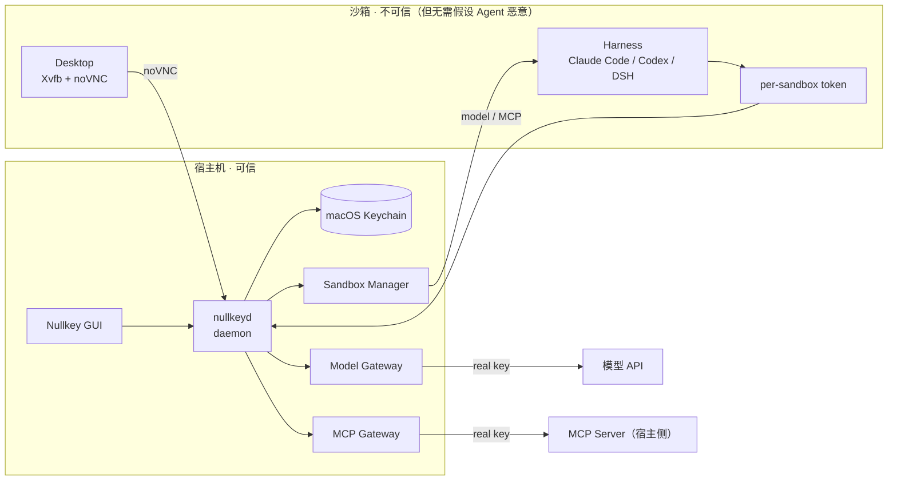

# Nullkey

> 桌面级 Agent 安全沙箱。API key、password 永远不进入沙箱。
>
> A desktop-grade secure sandbox for AI coding agents. Keys never enter the sandbox.

**Status:** design phase · macOS Apple Silicon first · 3-day MVP

## 为什么需要它

Agent session 会以很多方式离开你的电脑：transcript、调试日志、环境变量、MCP 配置、磁盘镜像、崩溃转储、共享桌面、导出的文件。只要真实 key 在沙箱里，任何一次 session 泄漏都可能变成 key 泄漏。

Nullkey 把沙箱变成 **zero-secret zone**：

- 沙箱里没有 API key、没有 password、没有 OAuth token、没有 SSH key。
- 沙箱里的 harness / MCP 配置只有一枚 **per-sandbox token**（可撤销、只在当前沙箱有效）。
- 真实凭证只在宿主机：macOS Keychain + Nullkey daemon。
- 模型请求和 MCP 调用都经过宿主侧网关，由网关在沙箱外注入真实凭证。
- 沙箱默认没有互联网，只能访问网关。

**即使整个沙箱磁盘/transcript 被拿走，也拿不到你的 key。**

## 怎么工作



一次模型调用：

```text
Harness → base_url=http://gateway/anthropic
        → Authorization: Bearer <sandbox-token>
        → Gateway 校验 token，换成真实 Anthropic key
        → 上游 API
        → 流式返回给 Harness
```

一次 MCP 调用：

```text
Harness → http://gateway/mcp/github
        → Authorization: Bearer <sandbox-token>
        → Gateway 找到宿主侧 GitHub MCP server
        → 注入真实 GitHub token，执行 tool call
        → 结果返回给 Harness
```

## 产品形态

- **本地 GUI**：首页选 harness；一键启动沙箱；浏览器里看虚拟桌面；Keys / MCP / Audit 三个管理页。
- **Harness 不随安装包分发**：从官方源下载到宿主缓存，校验版本/哈希，只读挂载进沙箱。
- **全局密钥（v1）**：所有沙箱共用一组 key；每个沙箱有独立 token、独立审计、可单独撤销。
- **凭证零填写**：MCP 配置、harness 配置、环境变量里都没有敏感信息；用户在 GUI 里填一次，之后不再碰。
- **macOS Apple Silicon 优先**：后端通过 `SandboxProvider` 抽象，后续接 Linux / Windows / microVM。

## 安全边界

**范围内**：session 泄漏导致的 key 泄漏。

- transcript / 日志 / 环境变量 / 进程参数
- harness 配置、MCP 配置、shell history
- 沙箱磁盘、快照、崩溃转储
- 导出文件、共享桌面、截图
- 宿主侧日志与 MCP server 日志

**范围外**（明确不承诺）：

- Agent 被 prompt injection 操控
- Agent 本身恶意、主动滥用自己的权限
- 目标网站/上游 API 被劫持
- 恶意 MCP server 实现
- 沙箱逃逸（我们做隔离，但不宣称经过认证的强隔离）
- 供应链攻击、物理访问

这个取舍是刻意的：三天内把"key 不进沙箱"做到可信、可验证、好用，比假装能防住所有 Agent 攻击更有价值。

## 计划支持

| 类别 | v1 | 说明 |
|---|---|---|
| Harness | Claude Code、Codex、DSH | 通过 base URL + per-sandbox token 接入；API key 模式 |
| MCP | GitHub、Slack、Notion、Postgres；Filesystem | 有凭证的在宿主侧，凭据由网关注入；Filesystem 在沙箱侧（无凭证）；v1 先做 2–3 个 |
| Host | macOS Apple Silicon | 后续 Linux / Windows |
| Auth | API key / gateway token | **OAuth 订阅登录（Claude Pro / ChatGPT Plus）不在 v1** |

## 文档

- [00 · 产品形态与范围](docs/00-product.md)
- [01 · 威胁模型与安全保证](docs/01-threat-model.md)
- [02 · 架构](docs/02-architecture.md)
- [03 · Harness 与 MCP 接入](docs/03-harness-mcp.md)
- [04 · 三天实施计划](docs/04-plan.md)
- [05 · 调研与选型](docs/05-research.md)
- [06 · 决策记录与开放问题](docs/06-decisions.md)

## 三天 MVP

Must：

- 本地 GUI + daemon；Colima/Docker 沙箱 + 虚拟桌面。
- Keychain 全局密钥；模型网关；Claude Code 跑通。
- 宿主侧 MCP 网关 + GitHub MCP；配置里零敏感信息。
- 启动/停止/删除沙箱；per-sandbox token 撤销；审计。
- "沙箱无密钥"检查 + 演示脚本。

Should：Codex / DSH 适配、第二个 MCP、Tauri 外壳。

Won't：OAuth、Windows/Linux host、多用户、microVM、原生安装包。

## 开发

TBD（docs-first，代码随后）。

## License

TBD。
