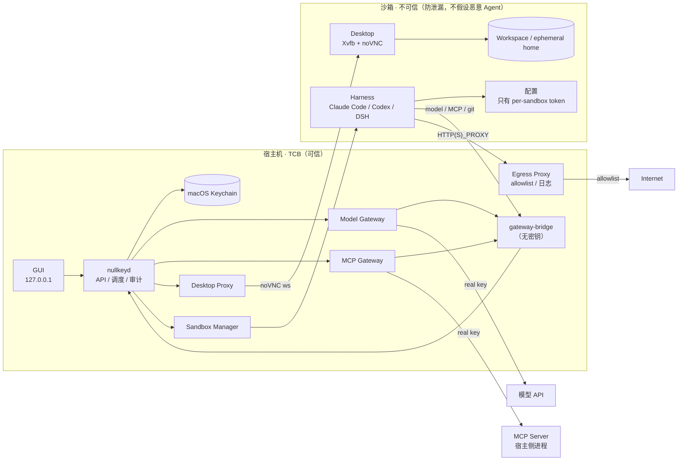

# 02 · 架构

## 1. 总览



三个关键点：

1. **沙箱可以上网，但只能经 egress proxy**；没有默认路由，不能直连 IP/DNS。
2. **沙箱里只有 per-sandbox token**，没有真实 key。
3. **真实 key 只在宿主**：Keychain + daemon + 宿主侧 MCP server；认证流量走 gateway，不走 proxy。

## 2. 组件职责

| 组件 | 位置 | 职责 | 不做什么 |
|---|---|---|---|
| GUI | 宿主 | harness 选择、key/MCP 管理、沙箱控制、桌面、审计 | 不把 key 传给沙箱 |
| `nullkeyd` | 宿主 | API、调度、配置渲染、审计、日志脱敏 | 不把 key 写日志 |
| Keychain helper | 宿主 | 读写 macOS Keychain | 不走 argv 传 key |
| Model Gateway | 宿主 | 校验 sandbox token，注入真实模型 key，流式转发 | 不记录 body |
| MCP Gateway | 宿主 | 托管/代理 MCP server，注入真实凭证，按连接路由 | 不把凭证返回沙箱 |
| Desktop Proxy | 宿主 | noVNC WebSocket 代理 + 一次性 ticket | 不暴露到 LAN |
| Sandbox Manager | 宿主 | 创建/启动/停止/删除沙箱，渲染配置 | 不挂宿主目录 |
| gateway-bridge | 宿主容器 | 把内部网络的 HTTP 转发到 daemon 的 UDS | 不持有任何密钥 |
| Egress Proxy | 宿主容器 | 双网卡；未认证互联网流量经此，按域名 allowlist 放行 | 不做 TLS MITM、不注入凭证 |
| Sandbox | 不可信 | 跑 harness、桌面、workspace | 没有 key；只有 proxy/gateway 路由 |
| MCP Server | 宿主 | 实际执行 MCP tool；持有自己的凭证 | 不把凭证写回沙箱 |

## 3. 信任边界

- **宿主 = TCB**：`nullkeyd`、Keychain、Model/MCP Gateway、MCP server。
- **沙箱 = 不可信**：按可能被导出、被读、被复制的假设设计；不假设 Agent 恶意。
- **上游 = 外部**：模型 API、第三方 MCP 服务；不在本地控制范围。
- **MCP server = 需要凭证的第三方代码**：它必须拿到真实凭证才能工作，因此它本身是"被信任到可以使用凭证"的组件；它不能把凭证回传给沙箱。恶意 MCP server 不在范围内（见威胁模型）。

## 4. 沙箱运行时

### 4.1 v1：Colima + Docker + 自定义桌面镜像

- **Colima**（Apache-2.0）：在 macOS Apple Silicon 上跑一个 Linux VM（Lima/vz），提供 Docker API。
- **Docker**：每个 sandbox 一个容器；容器共享 Colima VM 内核。
- **镜像**：Ubuntu ARM64 + Xfce + Xvfb + noVNC + 常用 CLI（git、node、python、ripgrep）。
- **隔离故事**：容器是内层，Colima VM 是外层；不挂宿主目录、不挂 Docker socket、不挂 Keychain；网络经 egress proxy，认证经 gateway。

为什么不是 Docker Desktop：商业使用需要订阅；Colima 是 Apache-2.0，本地优先。  
为什么不是 microVM：microsandbox / Apple `container` 更未来，但 beta / 桌面 / IPC 有不确定性；v1 先用 Colima 保交付，`SandboxProvider` 留好替换点。

### 4.2 Provider 接口

```go
type SandboxProvider interface {
    EnsureImage(ctx context.Context, image string) error
    Create(ctx context.Context, spec SandboxSpec) (Sandbox, error)
    Start(ctx context.Context, id string) error
    Stop(ctx context.Context, id string) error
    Destroy(ctx context.Context, id string) error
    Exec(ctx context.Context, id string, cmd []string) (ExecResult, error)
    CopyIn(ctx context.Context, id string, src, dst string) error
    Desktop(ctx context.Context, id string) (DesktopEndpoint, error)
    Status(ctx context.Context, id string) (Status, error)
}
```

`SandboxSpec`：harness、image、cpus、memory、workspace size、env（只有 token）、mounts（只读 harness 缓存）。

v0.2 可以增加 `MicroVMProvider`（microsandbox / Apple `container`），GUI 和网关不变。

## 5. 凭证路径

### 5.1 模型调用

```text
Harness 配置:
  base_url = http://gateway:8080/anthropic   (或 /openai)
  token    = <per-sandbox token>

Harness → Gateway:
  Authorization: Bearer <per-sandbox token>

Gateway:
  1. 校验 token → sandbox_id
  2. 查 sandbox 绑定的 provider（anthropic/openai/deepseek）
  3. 从 Keychain 取真实 key
  4. 替换 Authorization（Anthropic 用 x-api-key，OpenAI 用 Bearer）
  5. 转发到上游，SSE 流式回传

Harness 永远看不到真实 key。
```

- 每个 harness 有独立的适配器（见 [03-harness-mcp.md](03-harness-mcp.md)），负责把 base URL/token 写进正确的位置。
- Gateway 不记录请求/响应 body；只记录 provider、model、token 用量、状态码、耗时。
- 模型白名单：sandbox 只能请求 GUI 里启用的模型。
- 失败关闭：token 无效、key 缺失、上游 401 → 直接报错，不回退到直连。

### 5.1.1 凭证类型与 provider registry

| `auth_type` | 注入方式 | 典型 provider |
|---|---|---|
| `bearer` | `Authorization: Bearer <v>` | OpenAI、DeepSeek、OpenRouter、Groq、Mistral、xAI |
| `header` | 自定义 header | Anthropic `x-api-key`、Azure OpenAI `api-key` |
| `basic` | `Authorization: Basic` | 部分 MCP / 数据库 |
| `query` | URL query | Gemini |
| `sigv4` | AWS 签名 | Bedrock（v1.1） |
| `service_account` | GCP JWT | Vertex（v1.1） |
| `custom_header` | 用户指定 | 通用 endpoint |

provider registry 条目：`id, kind(llm|mcp), base_url, auth_type, header_name, models, test_path`。

网关适配器：

- **OpenAI-compatible**：覆盖大多数模型 provider。
- **Anthropic**：`x-api-key` + Anthropic 版本头。
- **Gemini / Azure OpenAI**：各自 endpoint 与 header。
- **Custom**：用户填 base URL + auth 类型 + header 名。

v1 目标 8–10 个模型 provider；MCP 支持静态 token / header / connection string。

### 5.1.2 OAuth

v1 只做"导入宿主已有登录"，不做授权流程：

- **Codex**：读取宿主 `~/.codex/auth.json`（用户授权）→ Keychain → 网关注入；刷新按 Codex 开源实现适配。
- **Claude Code**：使用 `claude setup-token` 生成的长期 token，或导入宿主 Keychain 中已有的登录 → 网关注入；过期后重新导入。
- 导入的 token 不进入沙箱；GUI 显示 `connected` / `expired`；过期返回 `reauth_required`。

v1.1：完整宿主侧 broker（PKCE + localhost callback + refresh）与 MCP OAuth（动态客户端注册）。详见 [03-harness-mcp.md](03-harness-mcp.md#6-oauth)。

### 5.2 MCP 调用

**宿主侧 MCP（有凭证）**：

```text
GUI: 连接 GitHub → 存 token 到 Keychain → 启动宿主侧 GitHub MCP server
Sandbox 配置:
  url = http://gateway:8080/mcp/github
  Authorization: Bearer <per-sandbox token>

Harness → Gateway → 路由到 GitHub MCP server（注入真实 token）→ 结果回传
```

- MCP server 的 stdout/stderr 留在宿主；stderr 捕获并脱敏，不挂进沙箱。
- Gateway 按连接 ID 路由；一个 sandbox 只能访问 GUI 里启用的连接。
- 支持两种 transport：
  - **Streamable HTTP**：harness 直接连 gateway。
  - **stdio**：沙箱里放一个极小的 `nullkey-mcp-bridge`，把 stdio JSON-RPC 转发到 gateway（同样带 token）。bridge 不含密钥。
- Tool allowlist：每个连接可以限制可用 tool（例如 GitHub 只允许 `search_repositories` / `get_file_contents`）。

**沙箱侧 MCP（无凭证）**：

- Filesystem 这类不需要密钥的 server 可以直接在沙箱里跑。
- 它只能看 workspace，不能看宿主。

### 5.3 虚拟桌面

```text
Sandbox: noVNC 监听 127.0.0.1:<port>
Host:    Desktop Proxy 把 127.0.0.1:<random> 映射到 sandbox 的 noVNC
GUI:     iframe / 新标签打开，带一次性 ticket
```

- 只绑 `127.0.0.1`，不绑 `0.0.0.0`、不暴露 LAN。
- 一次性 ticket（30 秒有效），防止别人猜端口。
- 剪贴板同步默认关闭；文件导入/导出走显式按钮。
- 桌面里的终端可以看到 `NULLKEY_TOKEN`，但看不到真实 key。

### 5.4 CLI / 自定义工具（v1 不做）

`git push`、`aws`、`gh` 这类需要 key 的 CLI 不在 v1 范围。未来用 **credential helper**：

- `git credential helper` 向 daemon 要一个短时、限定 host/repo 的令牌。
- 令牌进入沙箱，但短时、可撤销、权限窄。
- 这不是"零密钥"，是"低价值令牌"；在文档里单独标注。

## 6. Per-sandbox token

- 32 字节随机；Base64URL 编码；只在创建时显示给配置渲染器，不显示在 GUI。
- daemon 只存 `SHA-256(token)`；校验时哈希比对。
- 绑定 `sandbox_id`；不能跨沙箱使用。
- 生命周期 = 沙箱生命周期；停止/删除立即失效。
- 权限 = 该沙箱被允许的模型 provider + MCP 连接。
- 泄漏后的影响：在沙箱存活期间消耗模型/MCP 配额；可一键撤销。**不是长期 key 泄漏**。

## 7. Keychain

- Service：`com.nullkey.credentials`；Account：credential UUID。
- 使用 Security.framework（或一个极小的 Swift helper），**不要把 key 放进 argv**（`ps` 可见）。
- 访问控制：只允许 Nullkey 的签名身份；开发构建会出现系统授权弹窗。
- 元数据 SQLite：id、provider、label、fingerprint（SHA-256 前 8 字节）、created_at、last_used_at、status。
- GUI 永不显示明文；只显示 fingerprint 末四位。
- 删除 key：删 Keychain item + 标记 metadata；下一次调用失败。

## 8. 网络

### 8.1 三种模式

| 模式 | 沙箱路由 | 适用场景 | 默认 |
|---|---|---|---|
| `offline` | 仅 `gateway` | 敏感仓库、演示、完全不需要外网 | |
| `filtered` | 仅 `egress-proxy`（域名 allowlist） | 日常开发：包安装、公开文档、公开 git | ✅ |
| `open` | `egress-proxy`（全部放行） | 需要访问长尾站点；有数据外发风险 | |

模式在启动时选择；v1 改变模式需要重建沙箱。

### 8.2 拓扑

```text
Host / Colima VM
  nullkeyd
    ├── 127.0.0.1:<api>           GUI / REST
    ├── UDS                       gateway-bridge
    └── 127.0.0.1:<desktop>       noVNC proxy

nullkey-internal (internal=true，无外网网关)
  ├── gateway-bridge:8080         → daemon UDS（模型 / MCP / git）
  ├── egress-proxy:3128           → 互联网（仅未认证流量）
  └── sandbox                     （只能访问 gateway / proxy）

nullkey-egress (bridge，有外网)
  └── egress-proxy（第二块网卡）   → Internet
```

- 沙箱只接 `nullkey-internal`；该网络没有默认路由，唯一可达的是 `gateway` 和 `proxy`。
- `egress-proxy` 双网卡；只有它有外网。
- 沙箱环境：`HTTP_PROXY/HTTPS_PROXY=http://proxy:3128`、`NO_PROXY=gateway,localhost`。
- DNS：沙箱不配置外网 DNS；proxy 负责解析目标域名。内部名由 Docker DNS 解析。
- 除 noVNC 外，v1 不发布 sandbox 端口；noVNC 通过 `127.0.0.1:<random>` 映射 + 一次性 ticket。

### 8.3 强制与绕过

- `internal` 网络没有外部网关：直连公网 IP、直连外部 DNS 都失败。
- 不读取 proxy 环境的程序会直接失败（fail closed），不会"绕过"。
- v1.1 可在 sandbox 内用 iptables 把 80/443 REDIRECT 到 proxy，兼容不识别 proxy 的程序（需要 `NET_ADMIN`）。
- **代理不做 TLS MITM**：HTTPS 走 CONNECT 隧道，只能看到目标 host/SNI，不能改 header，因此**不能注入凭证**。
- 认证流量必须走 gateway：模型、MCP、git。

### 8.4 认证流量

| 流量 | 路径 | 凭证位置 |
|---|---|---|
| 模型 API | `gateway/{anthropic,openai}` | Keychain → gateway |
| MCP | `gateway/mcp/<id>` | Keychain → 宿主 MCP server |
| Git（HTTPS） | `gateway/git/<provider>/<owner>/<repo>.git` | Keychain → gateway |
| 包管理器 | `proxy` → registry | 无（公开 registry） |
| 公开网页/git clone | `proxy` | 无 |
| 私有 `git push` | gateway git proxy | Keychain → gateway |
| 其他认证 CLI（gh/aws） | v1 不支持 | 后续 credential helper |
| SSH git | v1 不支持 | 用 HTTPS remote |

**Git smart HTTP proxy**（v1 Should）：

```text
sandbox:
  git remote set-url origin http://gateway:8080/git/github/alice/demo.git

gateway:
  /git/github/alice/demo.git → https://github.com/alice/demo.git
  注入 Authorization: Bearer <real token>
  透传 info/refs、git-upload-pack、git-receive-pack
```

- 支持 clone / fetch / push；策略绑定 repo。
- token 不进入 sandbox；git 配置里只有 gateway URL + per-sandbox token。
- 需要处理重定向、chunked、大包体；Go `httputil.ReverseProxy` 可覆盖大部分。

### 8.5 策略与日志

- `filtered` 默认 allowlist：npm、PyPI、GitHub、常见文档站；可按沙箱编辑。
- `open` 全部放行，GUI 显示警告。
- 代理日志：时间、host/SNI、字节数、状态；不记录内容。
- 限流/大小限制；异常目标告警。
- 审计事件记录 mode、目标、是否放行。
- v1 代理实现：Squid（成熟）或自写 Go CONNECT proxy；只做 host/SNI allowlist，不做 MITM。

### 8.6 边界

- **网络不是 key 控制**：key 控制在 gateway；沙箱有网也拿不到 key。
- `filtered` 降低数据外泄面；`open` 允许外发；prompt injection / 恶意 Agent 不在威胁模型内。
- 浏览器登录后的 cookie 是另一类凭证；v1 建议只做公开浏览，登录态需要单独设计（临时 profile、停止即删、或禁用）。

## 9. 数据模型与 API

```sql
credentials(id, provider_id, label, keychain_account, fingerprint, auth_type, base_url, header_name, oauth_status, oauth_expires_at, created_at, last_used_at, status)
mcp_connections(id, server_id, label, auth_type, keychain_account, config_json, status)
sandboxes(id, harness_id, status, network_mode, token_hash, container_id, desktop_port, created_at, last_used_at)
audit_events(id, ts, sandbox_id, type, detail_json)
```

- `config_json` 只存非敏感配置（scopes、repo allowlist、tool allowlist）。
- `detail_json` 不含 key/token 明文。

API 草图：

```text
GET    /api/harnesses
POST   /api/harnesses/:id/install
GET    /api/credentials
POST   /api/credentials              {provider_id,label,value,auth_type,base_url,header_name}
GET    /api/credentials/importable
POST   /api/credentials/import       {source}
POST   /api/credentials/:id/reimport
POST   /api/credentials/:id/test
DELETE /api/credentials/:id

GET    /api/mcp/catalog
GET    /api/mcp/connections
POST   /api/mcp/connections          {server_id,label,auth_type,value,config}
POST   /api/mcp/connections/:id/test
DELETE /api/mcp/connections/:id

POST   /api/sandboxes                {harness_id,network_mode}
POST   /api/sandboxes/:id/stop
DELETE /api/sandboxes/:id
GET    /api/sandboxes/:id/desktop
POST   /api/sandboxes/:id/scan

GET    /api/audit
```

## 10. 生命周期

### 创建

1. GUI 选择 harness，`POST /api/sandboxes`。
2. daemon 生成 sandbox_id + token；插入 DB。
3. 确保镜像（首次拉取/构建）。
4. 创建 ephemeral home + workspace volume。
5. 渲染 harness 配置、MCP 配置（只有 gateway URL + token）。
6. 创建容器（internal network，只读 rootfs，非 root，资源限制）。
7. 启动 Xvfb + noVNC + harness。
8. 健康检查（gateway 可达、noVNC 就绪）。
9. 返回 desktop URL（带 ticket）。

### 停止 / 删除

- 停止：撤销 token → 停止容器 → 默认删除 home/transcript → 保留 workspace（可选）。
- 删除：删除容器 + volumes + DB 记录 + token。
- daemon 重启：**所有 sandbox token 失效**（fail closed）；GUI 提示重建沙箱。

## 11. 失败模式

| 情况 | 行为 |
|---|---|
| Gateway 不可用 | 模型/MCP 调用 502；不直连、不回退 |
| token 无效/过期 | 401；GUI 提示重建沙箱 |
| key 缺失/被撤销 | 424 `credential_unavailable`；提示去 Keys 添加 |
| MCP server 崩溃 | 503；不自动改用其他 server |
| 上游 401/429 | 透传状态；不重试风暴 |
| Colima 未启动 | GUI 引导启动；不静默失败 |
| 桌面端口冲突 | 重新分配随机端口 |
| 沙箱健康检查失败 | 标记 failed；保留日志；允许重试 |

## 12. 加固清单

- 容器：非 root、只读 rootfs、`/tmp` tmpfs、`cap-drop ALL`、`no-new-privileges`、pids/memory 限制。
- 不挂：宿主目录、`~/.ssh`、`~/.aws`、`~/.config/gh`、Keychain、Docker socket。
- 网络：internal 无默认路由；只有 `gateway` 与 `egress-proxy`；认证流量走 gateway。
- 镜像：固定 digest；无 secret layer；`gitleaks` 扫描；最小化。
- 日志：统一 redaction；不记录 body；MCP stderr 捕获。
- core dump：沙箱内禁用；宿主 daemon 也禁用（避免内存里的 key 落盘）。
- noVNC：127.0.0.1 + 一次性 ticket；不要放到 LAN。
- 剪贴板：默认关闭；文件传输显式。
- 停止：撤销 token + 删除 home；workspace 保留需用户选择。

## 13. 为什么不是其它方案

| 方案 | 为什么不够 |
|---|---|
| 把 key 放 env / `.env` | session 泄漏（transcript、日志、`env`）直接带走 key |
| 只做模型占位符 | 需要模型配合 + schema 兼容；主流 harness/MCP 用 base URL 就能透明解决 |
| 只做出口代理（TLS MITM） | 复杂、证书问题；MCP/harness 配置仍然要填东西 |
| 只做容器隔离 | 隔离不等于没密钥；容器里照样能 `env` |
| 用 Docker Desktop | 商业许可；Colima 更轻、Apache-2.0 |
| v1 直接上 microVM | beta/桌面/IPC 风险；先用 Colima 保交付，接口留好 |

## 14. Harness 集成摘要

每个 harness 一个 adapter，负责：

1. 安装（宿主缓存、版本/哈希、只读挂载）。
2. 配置渲染（base URL、per-sandbox token、MCP 配置路径）。
3. 启动命令 + 环境变量（禁用自动更新/遥测）。
4. 健康检查。

具体配置见 [03-harness-mcp.md](03-harness-mcp.md)。
