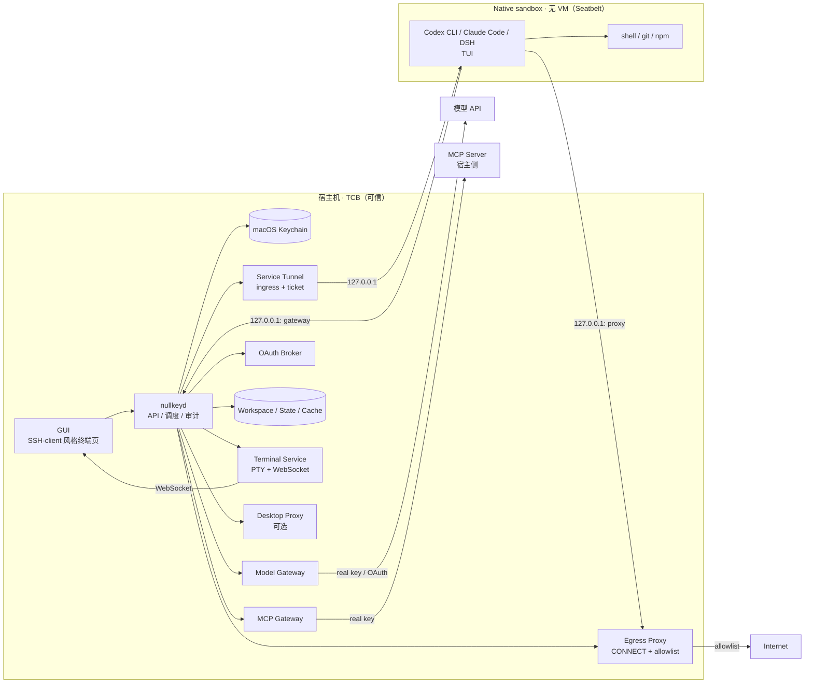

# 02 · 架构

## 1. 总览



三个关键点：

1. **默认 runtime 不是 VM**：原生 macOS 进程 + Seatbelt profile；启动快、内存低。
2. **Nullkey 只向沙箱注入 per-sandbox token**；其管理的真实凭证只在 Keychain + gateway；用户自带文件不受这一保证覆盖。
3. **网络与凭证正交**：未认证流量经 egress proxy；认证流量经 gateway。沙箱有网也拿不到 key。

> 这张图只画 v1 的凭证路径。宿主 CLI（gh/aws/kubectl/terraform）和沙箱内长驻服务属于 v1.1/Should 扩展，见 [13-host-tools-and-services.md](13-host-tools-and-services.md)；不改变"凭证不进沙箱"的原则。

## 2. 组件职责

| 组件 | 位置 | 职责 | 不做什么 |
|---|---|---|---|
| GUI | 宿主 | 终端页、桌面页、凭证/工作区/MCP 管理 | 不把凭证传给沙箱 |
| `nullkeyd` | 宿主 | API、调度、配置渲染、审计、日志脱敏 | 不记录凭证 |
| Terminal Service | 宿主 | PTY、WebSocket、resize、exit | 不解析终端内容 |
| Service Tunnel | 宿主 | 宿主 → 沙箱 WebUI/preview；一次性 ticket | 不做任意端口转发 |
| Runtime | 宿主 | 启动/停止 harness 进程，套 Seatbelt profile | 不挂宿主 home |
| Keychain helper | 宿主 | 读写 macOS Keychain | 不走 argv 传 key |
| Model Gateway | 宿主 | token → sandbox，注入 API key/OAuth，流式转发 | 不记录 body |
| MCP Gateway | 宿主 | 宿主侧 MCP server，注入凭证，按连接路由 | 不把凭证返回沙箱 |
| OAuth Broker | 宿主 | PKCE、callback、refresh、Keychain | 不在沙箱内登录 |
| Egress Proxy | 宿主 | CONNECT + 域名 allowlist，无 MITM | 不注入凭证 |
| Desktop Runtime | 可选 | 虚拟桌面/桌面 app，按需启动 | 不进入默认 SLO |
| Sandbox | 不可信 | 跑 harness、shell、workspace | 不接收 Nullkey 注入的真实凭证；用户自带文件另计 |

## 3. 信任边界

- **宿主 = TCB**：daemon、Keychain、gateway、OAuth broker、MCP server、egress proxy。
- **沙箱 = 不可信**：按可能被导出、被读、被复制的假设设计；不假设 Agent 恶意。
- **上游 = 外部**：模型 API、第三方 MCP；不在本地控制范围。
- **桌面 runtime = 可选、更重的边界**：只用于 GUI；不改变"无凭证"原则。

## 4. Runtime

### 4.1 Native（默认，无 VM）

- macOS `sandbox-exec` / Seatbelt profile（`sandbox-exec` 在新系统仍可用；实现时验证，必要时改用 `sandbox_init` API）。
- 直接运行 macOS 原生 harness：Codex（Rust）、Claude Code（Node）、DSH（Node）。
- 每个 sandbox 独立：
  - workspace 目录（可持久化/共享）；
  - state 目录（作为沙箱 HOME；harness 配置/会话，持久化）；
  - cache（共享，只读或读写）；
  - 环境变量只注入 `NULLKEY_TOKEN`、`NULLKEY_GATEWAY`、`NULLKEY_PROXY`。
- Seatbelt profile 原则：
  - `deny default`；
  - 只允许读系统库、harness 安装目录、workspace/state/cache；
  - 沙箱 `HOME` 指向 state 目录；拒绝宿主 `$HOME`、`~/.ssh`、`~/.aws`、Keychain、`mach-lookup` 敏感服务；
  - 允许 `network-outbound` 仅到 `127.0.0.1` 的 gateway/proxy 端口（端口级规则需在实现时验证；无法执行声明策略则拒绝启动，不静默放宽）；
  - 允许执行白名单内的 harness/shell/git/npm。
- 隔离级别：进程沙箱，不是 VM。能防 session 泄漏和误读宿主文件；不宣称防住 determined escape。

### 4.2 Desktop（可选）

- 虚拟桌面/桌面 app 需要 GUI 环境；macOS 上运行 Linux GUI 需要轻量虚拟化。
- 只在用户点"Open Desktop"时启动；单独计量，不计入默认 SLO。
- 不注入 Nullkey 管理的真实凭证；网络经 proxy/gateway。
- 如果"完全不用虚拟化"是硬约束，v1 只交付 TUI，desktop 延后。

### 4.3 Provider 接口

```go
type Runtime interface {
    Create(ctx context.Context, spec SandboxSpec) (Sandbox, error)
    Start(ctx context.Context, id string) error
    Stop(ctx context.Context, id string) error
    Destroy(ctx context.Context, id string) error
    Exec(ctx context.Context, id string, argv []string) (ExecResult, error)
    Terminal(ctx context.Context, id string) (PTY, error)
    Desktop(ctx context.Context, id string) (DesktopEndpoint, error)
    Services(ctx context.Context, id string) ([]Service, error)
    Stats(ctx context.Context, id string) (Stats, error)
}
```

`NativeRuntime` 是 v1 默认；`DesktopRuntime` 可选。

## 5. GUI 与终端交互

- GUI 本身不是 TUI 风格；默认打开的是 **SSH-client 风格的 Terminal 页**。
- 终端里运行的是 **harness 自己的 TUI**（Codex TUI、Claude Code TUI、DSH TUI）。
- `Terminal Service` 用 PTY 启动 shell/harness，WebSocket 推流；前端用 xterm.js 渲染。
- 支持 resize、复制、全屏、断线重连（Must）；PTY 归 daemon 管理，生命周期不绑定 WebSocket 或窗口。
- 关闭/刷新视图、客户端断线不结束任务；重连接回同一 PTY。只有停止/删除 sandbox 或进程退出才结束会话；daemon 重启不能恢复原 PTY，GUI 明确提示重启后可恢复持久化会话。
- v1 不保存服务器端 scrollback；重连触发 resize/SIGWINCH 请求 TUI 重绘，GUI 提示断线期间历史输出不可恢复。就绪信号和单写连接规则见 [终端契约](08-api-contract.md#37-terminal)。
- Codex TUI 直接跑在 PTY 里；不需要虚拟桌面。
- 桌面是独立 tab/window；打开时才创建 desktop runtime。
- 终端内容不进入模型网关；只有 harness 自己发起的模型请求才走 gateway。

### 5.1 Ingress 服务隧道

- 宿主 GUI 通过 `127.0.0.1` 的 Tunnel Proxy 打开沙箱内 WebUI/preview。
- 只转发 adapter 声明过的 service；一次性 ticket；只绑 loopback。
- 支持 HTTP/WebSocket/SSE；不做任意端口转发。
- 让 DSH 这类只有 WebUI 的 harness 可用；Agent 产物可在 Artifacts 页审查。
- 详细设计见 [09-service-tunnel.md](09-service-tunnel.md)。

## 6. 凭证路径

### 6.1 模型

```text
Codex config:
  base_url = https://127.0.0.1:<gateway>/openai
  chatgpt_base_url = https://127.0.0.1:<gateway>/backend-api
  env_key  = NULLKEY_TOKEN
  CODEX_CA_CERTIFICATE = state/nullkey/gateway-ca.pem

Gateway (same loopback port muxes HTTP + TLS):
  token → sandbox_id
  取 Keychain 中的 API key 或 OAuth access token（Codex ChatGPT 走 backend-api/codex）
  注入 Authorization / ChatGPT-Account-Id（删除沙箱同名头）
  流式回传
```

### 6.2 MCP

- 有凭证的 MCP 在宿主侧运行；沙箱配置只有 `http://127.0.0.1:<gateway>/mcp/<id>` + token。
- stdio-only harness 用 `nullkey-mcp-bridge` 转发到 gateway。
- Filesystem 等无凭证 MCP 可以在沙箱侧，仅限 workspace。

### 6.3 私有 Git

```text
sandbox: git remote = http://127.0.0.1:<gateway>/git/github/<owner>/<repo>.git
gateway: 注入真实凭证 → https://github.com/...
```

- 支持 clone/fetch/push；策略绑定 repo；token 不进沙箱。
- SSH git 不支持；用 HTTPS remote。

### 6.4 OAuth

- 宿主侧 OAuth Broker：Authorization Code + PKCE，localhost callback，Keychain 存 access/refresh token。
- Codex OAuth 为 v1 Must；MCP OAuth（DCR）为 Should；Claude Code 导入为 Should。
- Gateway 注入 OAuth token；到期前刷新；失败返回 `reauth_required`。
- **沙箱内不发起登录**。

## 7. Per-sandbox token

- 32 字节随机；Base64URL；只在配置渲染时使用，不显示在 GUI。
- daemon 只存 SHA-256；绑定 sandbox_id；生命周期 = sandbox。
- 权限 = 该 sandbox 被允许的模型 provider + MCP 连接 + git repo。
- 停止/删除立即失效；daemon 重启全部失效（fail closed）。
- 泄漏影响：sandbox 存活期内消耗配额；可一键撤销。不是长期凭证泄漏。

## 8. Keychain

- Service `com.nullkey.credentials`；Account = credential UUID。
- 使用 Security.framework 或极小 Swift helper；不要把 key 放进 argv。
- 元数据 SQLite：id、provider、label、fingerprint、auth_type、oauth_status、expires_at。
- GUI 只显示 fingerprint 末四位；永不显示明文。
- OAuth refresh token 同样只存 Keychain。

## 9. 网络

### 9.1 模式

| 模式 | 用户名称 | 行为 |
|---|---|---|
| `services_only` | 仅允许已连接服务 | 禁用通用 egress；模型/MCP/私有 git 仍可经 gateway 联网 |
| `filtered`（默认） | 限定网站 | gateway + egress 域名 allowlist，适合包安装、公开文档、公开 git |
| `open` | 开放网站 | gateway + egress 全放行，适合长尾站点；仍有数据外发风险 |

三档都不是离线模式，都可能通过模型/MCP/git 向外发送数据；GUI 在选项旁直接说明，不推荐 `services_only` 作为敏感数据不外发的保证。v1 不提供完全离线模式。模式是实际执行策略；无法执行时拒绝启动，不以同名模式静默放宽限制。

### 9.2 Native 网络拓扑

```text
sandbox process (Seatbelt)
  ├── 127.0.0.1:<gateway>   模型 / MCP / git
  └── 127.0.0.1:<proxy>     HTTP(S)_PROXY，未认证流量
        │
        └── egress proxy（宿主进程）── allowlist ──> Internet
```

- Seatbelt 只允许 outbound 到 localhost 的 gateway/proxy 端口；直连公网 IP/DNS 拒绝。
- 沙箱设置 `HTTP_PROXY/HTTPS_PROXY=http://127.0.0.1:<proxy>`、`NO_PROXY=127.0.0.1,localhost`。
- 代理只做 CONNECT 隧道 + host/SNI allowlist；**不做 TLS MITM**，不装 CA，不改 header。
- 认证流量不走通用代理；走 gateway 专用端点。

### 9.3 强制与绕过

- Seatbelt 的 network 规则是主控制；proxy 是唯一外网出口。
- 不识别 proxy 的程序失败（fail closed）。
- v1.1 可加本地透明重定向，兼容不识别 proxy 的程序。
- 代理日志：时间、host/SNI、字节数、状态；不记录内容。

### 9.4 边界

- 网络不是 key 控制；key 控制在 gateway。
- `filtered` 降低数据外泄面；`open` 明确警告；prompt injection/恶意 Agent 不在威胁模型内。
- 浏览器登录 cookie 是另一类凭证；v1 只建议公开浏览。

## 10. 状态与挂载

- 三类状态：`workspace`（项目文件）、`state`（harness 配置/会话）、`cache`（harness/npm/pip 缓存）。
- 默认持久化；workspace 可共享（rw 独占 / ro 共享）；cache 全局共享。
- 自定义 host mount 需显式确认；禁止 `$HOME`、`~/.ssh`、`~/.aws`、Keychain。
- 详细目录、锁、重置策略见 [07-state-and-mounts.md](07-state-and-mounts.md)。

## 11. 数据模型（摘要）

```sql
workspaces(id, name, root_path, storage_kind, mode, created_at, last_used_at)
states(id, harness_id, path, created_at, last_used_at)
sandboxes(id, harness_id, workspace_id, state_id, runtime, network_mode, status, token_hash, pid, created_at)
credentials(id, provider_id, label, keychain_account, fingerprint, auth_type, oauth_status, expires_at)
mcp_connections(id, server_id, label, auth_type, keychain_account, config_json, status)
services(id, sandbox_id, name, target_host, target_port, protocol, status)
audit_events(id, ts, sandbox_id, type, detail_json)
```

完整 API、错误码、WebSocket/SSE 见 [08-api-contract.md](08-api-contract.md)。

## 12. 生命周期

1. `POST /sandboxes`：选择 harness/workspace/state/network_mode。
2. 生成 per-sandbox token；渲染配置（token 从 env 注入，不落配置文件）。
3. 创建/复用 workspace、state、cache；加锁。
4. 启动进程，套 Seatbelt profile；启动 PTY。
5. 返回 terminal WebSocket ticket；可选 desktop/service ticket。
6. adapter 注册 WebUI/preview service；daemon 健康检查。
7. 停止：撤销 token、停进程、释放锁；state/workspace 保留。
8. 删除：停止 sandbox 并删除其记录；始终保留 state/workspace；数据清理由独立接口执行。

## 13. 失败模式

| 情况 | 行为 |
|---|---|
| gateway 不可用 | 模型/MCP/git 502；不直连 |
| token 无效 | 401；重建 sandbox |
| OAuth 过期 | 401 `reauth_required`；GUI 重新登录 |
| proxy 不可用 | 未认证流量失败；认证流量不受影响 |
| workspace 被占用 | 409；提示只读挂载或等待 |
| Seatbelt profile 失败 | 启动失败；不降级为无沙箱运行 |
| desktop runtime 不可用 | TUI 正常；桌面按钮报错 |
| service 未声明/未就绪 | 404 `service_not_found`；不猜测端口 |
| tunnel ticket 过期 | 401 `ticket_invalid`；GUI 重新申请 |

## 14. 加固

- Seatbelt profile 最小权限；`deny default`。
- 不挂宿主 home/SSH/Keychain；workspace/state 之外只读。
- token 只通过 env 注入；不写配置文件。
- 日志/审计/终端录制统一脱敏；core dump 关闭。
- harness 安装目录只读；版本/哈希固定。
- egress proxy allowlist；`open` 模式显式警告。
- 私有 git 走 gateway；不把 PAT 写进 `.git/config`。

## 15. 选型结论

| 层 | 选型 |
|---|---|
| 默认 sandbox | **macOS Seatbelt 进程沙箱**（无 VM） |
| 可选桌面 | Apple `container`（microVM，首选）/ microsandbox（备选）；只在 Open Desktop 时启动 |
| Harness | Codex 原生（Must）；Claude Code/DSH 原生（Should） |
| 网络 | 宿主 egress proxy + gateway；无默认 VM 网络 |
| 隧道 | 宿主 loopback ingress tunnel，仅声明服务 |

## 16. 为什么不是 VM / 容器

| 方案 | 为什么不选为默认 |
|---|---|
| Colima / Docker Desktop | 需要 Linux VM；启动/内存重；与"轻量"目标冲突 |
| microVM（microsandbox 等） | 更轻，但仍是 VM；桌面/IPC 有不确定性；可作为可选 desktop 后端 |
| 纯容器（macOS） | 仍然依赖 VM；没有额外收益 |
| 纯 Seatbelt | 默认选它：无 VM、启动快；隔离弱于 VM，但匹配 session 泄漏威胁模型 |
| 只断网 | 局限太大；网络与 key 隔离正交 |

> 默认不用 VM；如果评审要求"认证级强隔离"，那是另一个产品目标，需要 VM 后端，单独评估。
